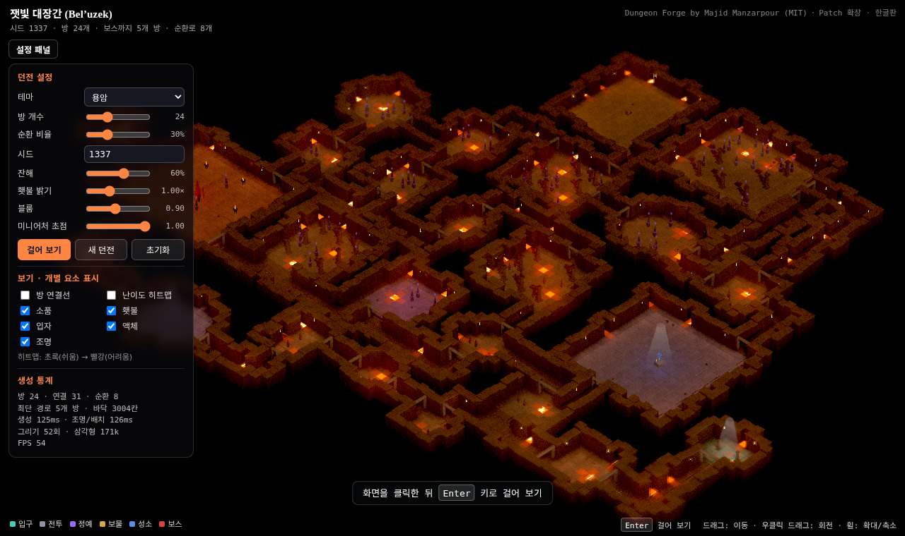
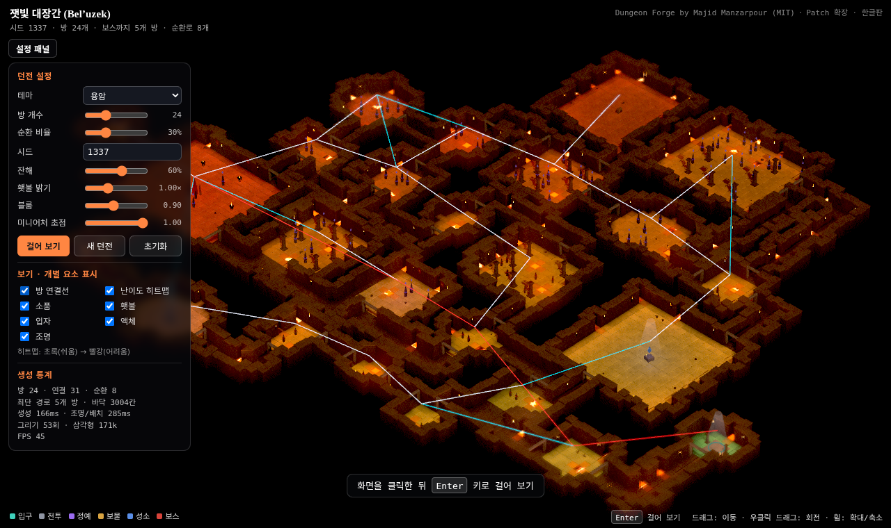
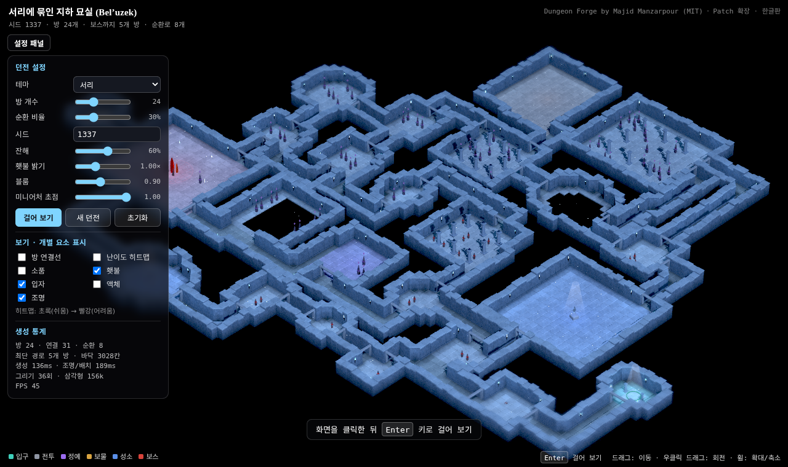
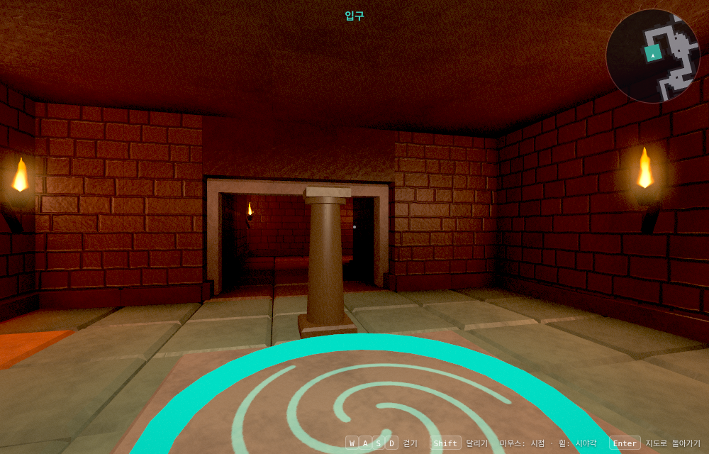

# 던전 포지 한글판 (Dungeon Forge · Korean Edition)

시드 하나로 던전을 만들고, 위에서 내려다본 뒤 **Enter 키로 내려가 1인칭으로 직접 걸어 다니는** 절차적 던전 생성기의 한글판입니다. 방 역할·테마·설정 패널·생성 통계가 모두 한국어로 표시됩니다.

- 플레이: https://sigco3111.github.io/dungeon-forge-ko/ (GitHub Pages 배포 후)
- 원작: [majidmanzarpour/threejs-procedural-dungeon](https://github.com/majidmanzarpour/threejs-procedural-dungeon) (Dungeon Forge, MIT)
- 기반: [Patch 「Dungeons」](https://patch.gg/patch/dungeons) (원작을 생성기/뷰로 나누고 복도 경로, 걷기, 천장, 조명을 추가, MIT)

## 스크린샷

| 지도(용암 테마) | 난이도 히트맵 + 방 연결선 |
|---|---|
|  |  |
| 서리 테마, 소품/액체 끔 | 1인칭 걷기(입구 방) |
|  |  |

## 기능

- **세부 던전 설정**: 테마(고대/용암/서리/음산/녹음), 방 개수(8~60), 순환 비율, 시드, 잔해, 횃불 밝기, 블룸, 미니어처 초점. 같은 시드와 설정이면 항상 같은 던전이 나옵니다.
- **방 역할**: 입구, 전투, 정예, 보물, 성소, 보스. 입구에서 보스까지 최단 경로와 난이도가 계산됩니다.
- **연출과 탐험**: 지도에서 Enter를 누르면 카메라가 내려가 1인칭으로 걷습니다(WASD, Shift 달리기, 마우스 시점). 구운 조명, 횃불, 천장, 미니맵이 있습니다.
- **원작 도구 이식(한글판 추가)**: 난이도 히트맵(초록 쉬움 → 빨강 어려움), 방 연결선(최단 경로 빨강, 순환로 파랑), 소품/횃불/입자/액체/조명 개별 표시·숨김, 생성 통계(방·연결·순환, 생성 시간, 그리기 횟수, 삼각형, FPS).
- 방 이름은 시드에 따라 한국어로 만들어집니다(예: 잿빛 대장간).

## 조작

| 동작 | 입력 |
|---|---|
| 지도 이동 / 회전 / 확대 | 드래그 / 우클릭 드래그 / 휠 |
| 걸어 보기 ↔ 지도 | Enter |
| 걷기, 달리기, 시점 | WASD, Shift, 마우스(클릭으로 마우스 잠금, Esc로 해제) |
| 설정 | 왼쪽 패널 (모바일은 "설정 패널" 버튼) |

## 실행과 빌드

```bash
npm install
npm run dev     # http://127.0.0.1:5392
npm run build   # docs/ 에 정적 빌드 (GitHub Pages: main 브랜치 /docs)
npm test        # 생성기 검사
```

## 기술

Three.js 0.186.1, Vite. 렌더링은 WebGL(InstancedMesh)이고 텍스처·모델·사운드 파일이 없이 모두 코드로 생성합니다. 던전 생성과 조명 굽기는 Web Worker에서 합니다. 생성기(`src/generator.js`)는 three.js에 의존하지 않고 같은 입력이면 같은 결과를 냅니다. 한글판 변경: UI·테마·방 이름 번역, 설정 패널(`src/demo.js`), 히트맵(`src/level.js`), 레이어 토글(`src/view.js`), Hangul 부분 폰트(`src/fonts`).

## 한계

- 평면 한 층만 있고 계단은 없습니다. 적, 열리는 문, 전리품, 소리는 없고 스폰·상자 위치는 데이터로만 있습니다.
- 방 컬링이 없어 큰 맵은 무겁습니다. 실제 기기 성능은 작성자도 RTX 4090에서만 확인했다고 밝혔으며, 이 한글판은 소프트웨어 렌더링으로 동작만 확인했습니다.
- 브라우저의 WebGL이 필요합니다.

## 라이선스와 출처

MIT. 원작 Dungeon Forge (c) 2026 Majid Manzarpour, Patch 추가분 (c) 2026 Patch, three.js MIT. 폰트 Noto Sans KR 부분 집합은 SIL OFL 1.1입니다. 전문은 `LICENSE`, `LICENSE-dungeon-forge.txt`, `LICENSE-noto-sans-kr.txt`, `CREDITS.txt`에 있습니다. 원본 Patch README는 `README.en.md`로 보존했습니다.
